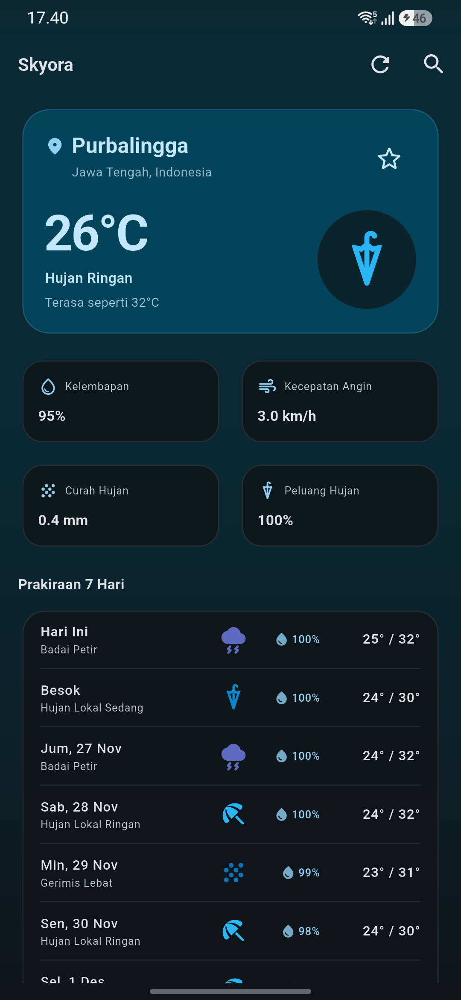
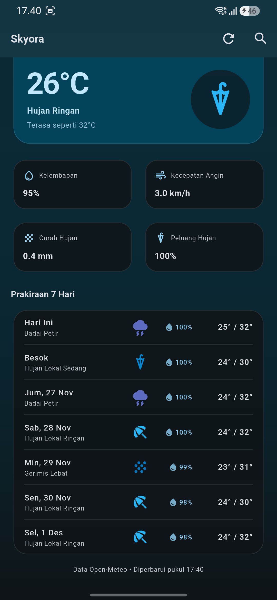
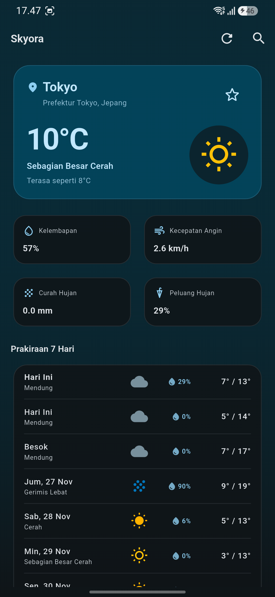
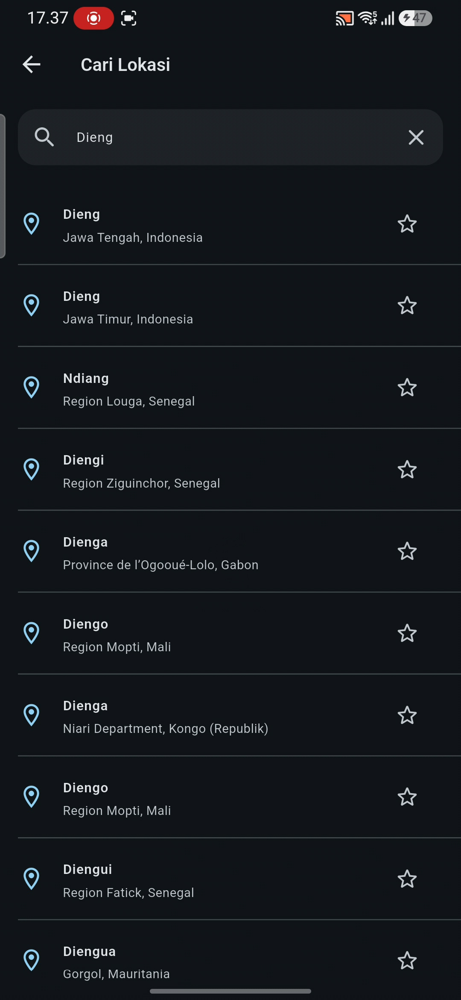
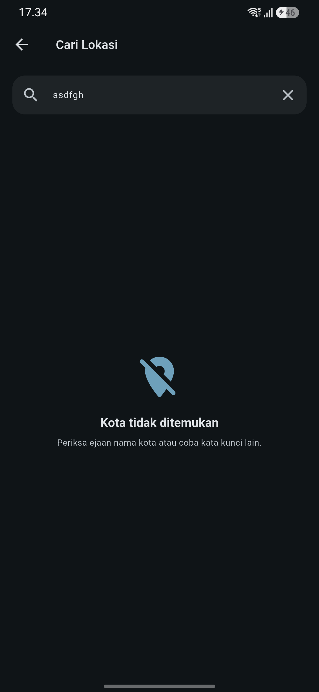
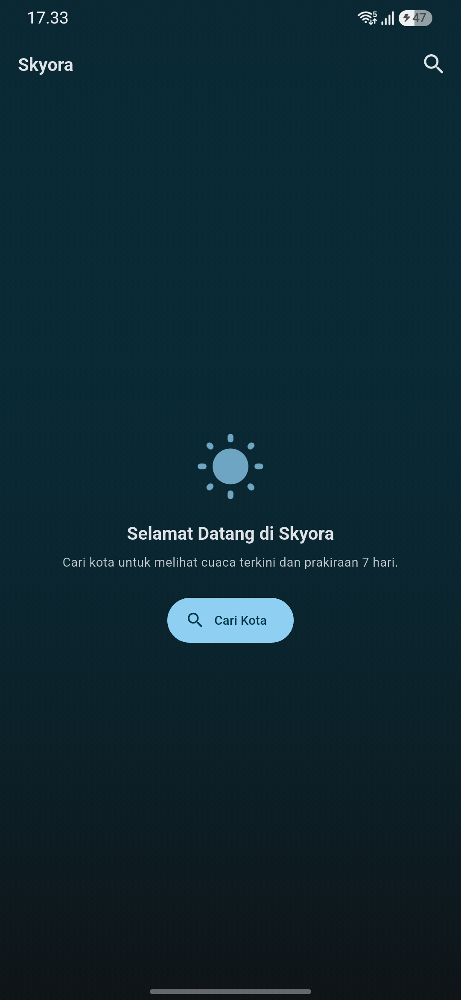
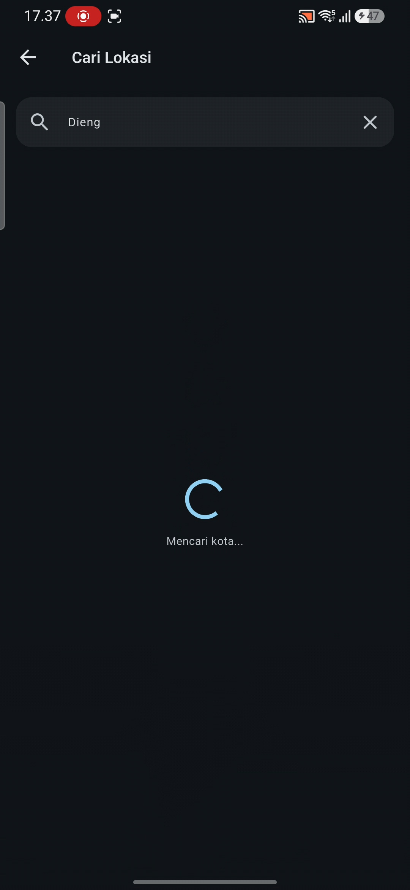
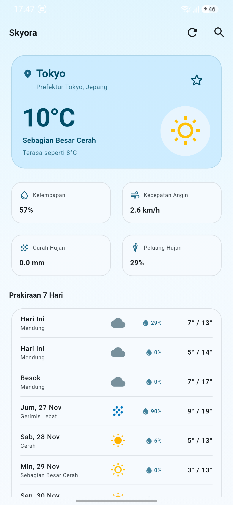

# Skyora - Aplikasi Prakiraan Cuaca (Responsi Praktikum Mobile)

**Nama** : Zahratul Askia  
**NIM** : H1D024016  
**Shift KRS** : B  
**Shift Sekarang** : F

Skyora adalah aplikasi prakiraan cuaca berbasis **Flutter** yang mengambil data dari **Open-Meteo API**. Aplikasi memakai arsitektur **MVVM**, state management **Provider**, dan penyimpanan lokal **shared_preferences**. Seluruh data cuaca berasal dari API, tidak ada data statis.

## Fitur

- Mencari kota berdasarkan nama (request nyata ke Geocoding API)
- Cuaca terkini: suhu, suhu terasa, kondisi cuaca, kelembapan, kecepatan angin, curah hujan, dan kemungkinan hujan
- Prakiraan cuaca 7 hari ke depan (suhu min/max dan peluang hujan)
- Menyimpan lokasi favorit dan riwayat pencarian (local storage)
- Lokasi terakhir dan favorit tetap tersimpan setelah aplikasi ditutup
- Penanganan kondisi loading, data kosong, dan error (tombol Coba Lagi)
- Pull-to-refresh pada halaman Home
- Tema biru langit (Material Design 3), mendukung mode terang dan gelap

## Teknologi

| Komponen | Keterangan |
|---|---|
| Bahasa / Framework | Dart / Flutter (Material Design 3) |
| API | Open-Meteo (Weather Forecast dan Geocoding), tanpa API key |
| Networking | package `open_meteo` (forecast) dan `http` GET (geocoding) |
| State management | `provider` (`ChangeNotifier`) |
| Penyimpanan lokal | `shared_preferences` |
| Arsitektur | MVVM |

## Struktur Aplikasi

```
lib/
├── main.dart                     # Inisialisasi storage, MultiProvider, dan Theme
├── models/
│   ├── location.dart             # Model lokasi (toJson/fromJson)
│   └── weather.dart              # Model CurrentWeather, DailyForecast, Weather
├── services/
│   ├── geocoding_service.dart    # Pencarian kota (HTTP GET ke Geocoding API)
│   ├── storage_service.dart      # Favorit, riwayat, dan lokasi terakhir
│   └── weather_service.dart      # Ambil cuaca lewat package open_meteo
├── utils/
│   └── weather_code.dart         # Pemetaan weather_code ke deskripsi dan ikon, format hari
├── viewmodels/
│   ├── search_viewmodel.dart     # State pencarian, favorit, dan riwayat
│   └── weather_viewmodel.dart    # State cuaca lokasi terpilih
├── views/
│   ├── home_screen.dart          # Halaman cuaca dan prakiraan 7 hari
│   └── search_screen.dart        # Halaman pencarian, favorit, dan riwayat
└── widgets/
    ├── current_weather_card.dart # Kartu cuaca terkini
    ├── daily_forecast_item.dart  # Item prakiraan harian
    ├── state_views.dart          # Tampilan loading, kosong, dan error
    └── weather_details_grid.dart # Detail kelembapan, angin, curah, dan peluang hujan
```

## Implementasi API

### 1. Geocoding API (pencarian kota)

`GET https://geocoding-api.open-meteo.com/v1/search`

| Parameter | Nilai |
|---|---|
| `name` | nama kota yang dicari |
| `count` | 10 |
| `language` | id |

Respons JSON di-decode dengan `jsonDecode`, lalu tiap item pada `results[]` diubah menjadi objek `Location` lewat `Location.fromJson()`. Jika `results` tidak ada, aplikasi menampilkan kondisi **data kosong** ("Kota tidak ditemukan"), bukan error.

### 2. Weather Forecast API

`GET https://api.open-meteo.com/v1/forecast` (melalui `WeatherApi` dari package `open_meteo`)

| Parameter | Nilai |
|---|---|
| `latitude`, `longitude` | koordinat kota terpilih |
| `timezone` | `auto` |
| `forecast_days` | 7 |
| `current` | `temperature_2m`, `relative_humidity_2m`, `apparent_temperature`, `precipitation`, `weather_code`, `wind_speed_10m` |
| `daily` | `weather_code`, `temperature_2m_max`, `temperature_2m_min`, `precipitation_probability_max` |

`WeatherService` mengonversi respons API menjadi model milik sendiri (`Weather`, `CurrentWeather`, `DailyForecast`), sehingga View dan ViewModel tidak bergantung pada tipe dari package. Kemungkinan hujan hari ini diambil dari `daily.precipitation_probability_max`.

### Penanganan error

Service menangkap kegagalan koneksi (`SocketException`), timeout (10 detik), status HTTP selain 200, dan format JSON tak terduga. Pesannya diteruskan ke ViewModel dan ditampilkan sebagai pesan error dengan tombol **Coba Lagi**.

## Penerapan MVVM

| Lapisan | Isi | Tanggung jawab |
|---|---|---|
| **Model** | `models/`, `services/` | Struktur data serta akses data (API dan penyimpanan lokal) |
| **View** | `views/`, `widgets/` | Menampilkan UI dan memanggil method ViewModel, tidak memanggil API atau storage langsung |
| **ViewModel** | `viewmodels/` | Menyimpan state (`initial`, `loading`, `success`, `empty`, `error`), memanggil service, lalu `notifyListeners()` |

**Alur data:**

```
Aksi pengguna (View)
   -> method ViewModel
   -> Service (Open-Meteo API / SharedPreferences)
   -> konversi ke Model
   -> update state + notifyListeners()
   -> View membangun ulang tampilan
```

## Cara Menjalankan

```
git clone https://github.com/<username>/H1D024016-Responsi-Flutter.git
cd H1D024016-Responsi-Flutter
flutter pub get
flutter run
```

Perangkat membutuhkan koneksi internet. Tidak perlu API key.

## Screenshot

### Home Screen

| Cuaca Terkini | Prakiraan 7 Hari | Kota Lain |
|:-:|:-:|:-:|
|  |  |  |
| Nama kota, kondisi, suhu, kelembapan, angin, dan kemungkinan hujan | Suhu min/max dan peluang hujan beberapa hari ke depan | Data berubah sesuai kota, bukti berasal dari API |

### Search Screen

| Hasil Pencarian | Favorit dan Riwayat | Kota Tidak Ditemukan |
|:-:|:-:|:-:|
|  |  |  |
| Daftar lokasi dari Geocoding API, dapat dipilih atau difavoritkan | Lokasi favorit dan riwayat dari local storage | Kondisi data kosong |

### Kondisi Tampilan dan Tema

| Belum Ada Lokasi | Loading | Error | Tema Terang |
|:-:|:-:|:-:|:-:|
|  |  |  |  |
| Ajakan mencari kota | Indikator saat data diambil | Pesan error dan tombol Coba Lagi | Tampilan mode terang |